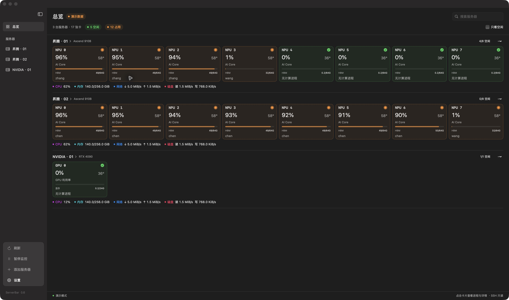
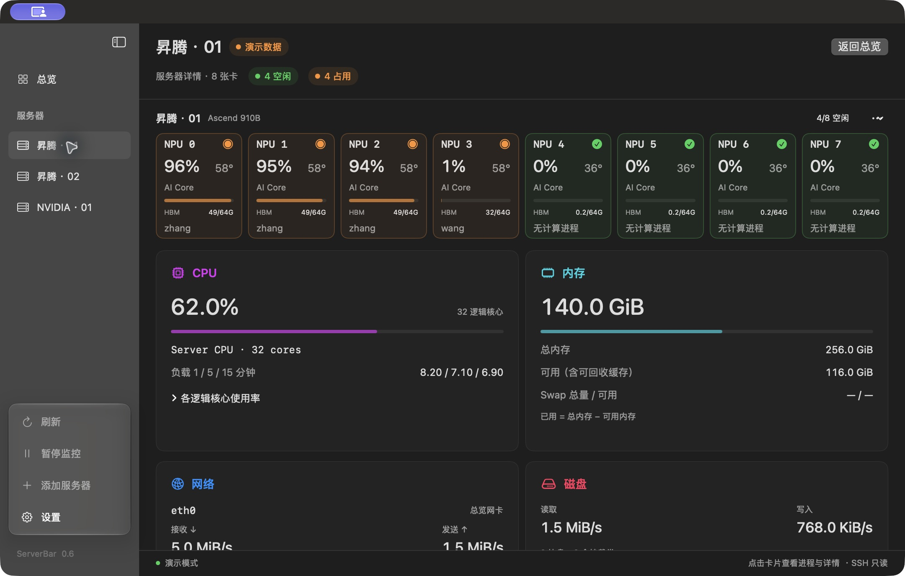
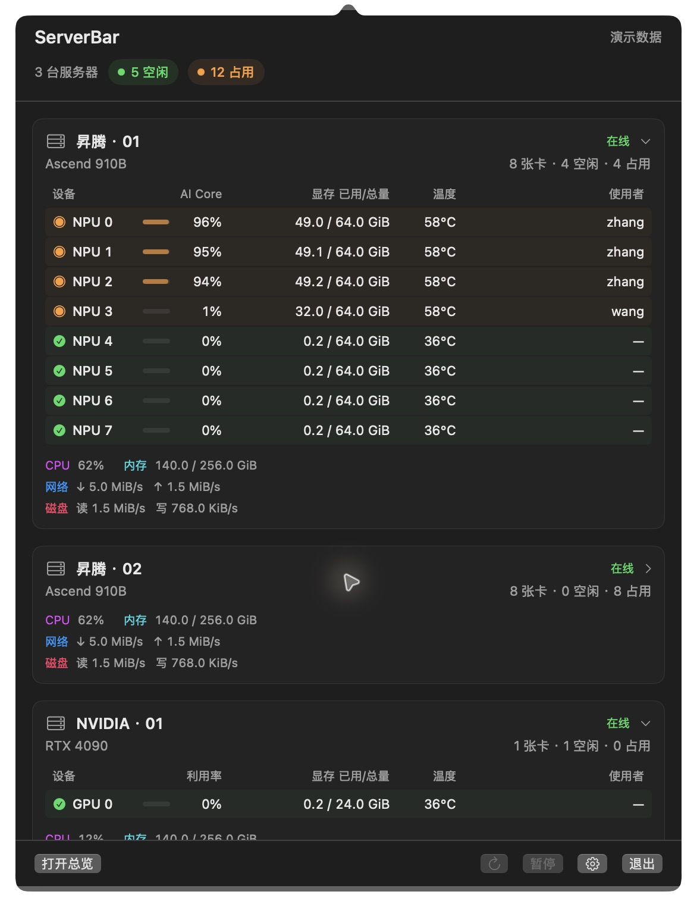

# ServerBar

在 Mac 状态栏，一眼查看远程服务器的空闲卡、运行程序和资源使用情况。

支持 NVIDIA GPU、昇腾 NPU、CPU、内存、网络和磁盘。SwiftUI + 系统 OpenSSH，无第三方运行时依赖，无需在服务器安装代理。

A lightweight macOS menu bar monitor for remote servers over SSH.

## 界面预览

以下为应用的实际截图，均使用内置演示数据；服务器名称、用户和指标为模拟内容，不包含真实 SSH 配置。

**多服务器总览** — 集中查看每张卡的利用率、温度、显存和使用者，绿色为空闲，橙色为占用。

**服务器详情** — 点击服务器后，展开该机的设备卡片与 CPU、内存、网络、磁盘面板。

**状态栏弹窗** — 无需打开主窗口即可查看逐卡信息；收起服务器后仍保留资源摘要。

## 下载

从 [GitHub Releases](https://github.com/toubeichuan/serverbar/releases/latest) 下载 DMG 安装包，打开后将 ServerBar 拖到 Applications。

当前安装包适用于 Apple Silicon（M 系列）Mac，要求 macOS 13 或更新版本。仓库为私有，需要使用有访问权限的 GitHub 账号登录才能下载。安装包为本地 ad-hoc 签名，尚未经过 Apple Developer ID 签名或公证，macOS 首次打开时可能阻止运行。

## 使用

打开 dist/ServerBar.app 后，默认仅在屏幕顶部状态栏运行，不显示 Dock 图标或自动打开主窗口。已在后台运行时再次打开应用会显示总览；也可点击顶部芯片图标，选择“打开总览”或设置，即可管理服务器。

设置 → 运行方式 → “仅状态栏运行”可切换此行为；关闭后恢复 Dock 图标，下次启动自动打开总览。该偏好保存在本机，服务器配置不变。关闭总览窗口始终继续监控，需要停止应用时点击状态栏弹窗的“退出”。

1. 自动读取 ~/.ssh/config 及 Include 文件，勾选具体 Host 别名并添加。
2. 也可以手动输入 SSH 别名 / IP，并按需覆盖用户名、端口或私钥路径。
3. 默认自动识别 NVIDIA / 昇腾，也可为服务器指定类型。
4. 默认每 20 秒刷新；点击卡片查看用户、PID、进程内存。关闭窗口后菜单栏仍可打开总览。

应用不修改 SSH 配置，不复制私钥，不在服务器安装程序。需要 Mac 本身可以使用密钥 / ssh-agent 非交互连接目标服务器。首次连接请先在终端核实主机指纹；应用不会自动接受未知或变化的主机密钥，也不会弹出密码输入框。HostName、IdentityFile、ProxyJump 等交由系统 SSH 处理。应用禁止当前会话的端口转发、代理转发和 LocalCommand。

**查看演示** 使用内置模拟数据（2 台 8 卡昇腾 + 1 台单卡 NVIDIA），不连接服务器，也不保存模拟服务器。

## 0.6 状态栏运行与紧凑工作区

- 黑白中性色、纯色背景、细分隔线，无渐变；侧栏采用原生半透明材质，侧栏控制组在 macOS 26+ 使用 Liquid Glass（旧系统回退到材质）；默认跟随系统浅色 / 深色外观，也可手动选择。
- 左侧总览 / 服务器 / 设置导航，可收起为图标栏（⌃⌘S）；刷新、暂停和添加也在侧栏，内容区位于原生标题栏下方；默认紧凑布局，每台服务器的 8 张卡同一行、统一高度。
- 卡片以绿 / 橙状态图标及轻微底色区分空闲 / 占用，去掉重复状态文字，放大数字并保留 AI Core / GPU 利用率标签；顶部显示空闲、占用与未知数量。
- 服务器搜索、只看空闲筛选；CPU、内存、网络、磁盘为可点击的摘要行。
- 设置页可自由选择 GPU / NPU、CPU、内存、网络、磁盘，偏好自动保存。隐藏的面板停止对应的采集。
- 服务器标题旁显示设备型号，卡片显示利用率、温度、显存和用户；详情显示进程、PID、用户、程序 / 脚本名、显存、温度、可用时的功耗。
- 程序标签仅读取计算 PID 的可执行名和 Python 模块 / 脚本名，不显示完整参数。远端没有 Python 3 或权限不足时退回驱动提供的进程名。
- 菜单栏弹出面板显示总空闲 / 占用数量、服务器型号与卡数；逐卡表格有明确的利用率、显存、温度、使用者列标题，可直接点击打开详情。服务器标题可收起逐卡表格，CPU、内存已用 / 总量、网络与磁盘读写摘要继续保留。
- CPU 使用率与网卡速率基于相邻两次采样差值，首轮显示“采样中”。CPU 详情显示每个逻辑核心。
- 网络总览默认显示 IPv4 默认路由网卡；无匹配路由时取累计流量最多的非回环接口。详情可查看所有非回环网卡，不混加虚拟网卡流量。
- 内存按 MemTotal − MemAvailable 计算；磁盘显示所有本地 /dev 挂载卷的容量、已用和可用空间（含 /data 等数据盘，排除 tmpfs 与 loop）。
- 磁盘摘要显示读 / 写速率，详情列出整盘容量与各盘速率。采集 /sys/block 的底层整盘计数，排除分区、loop 和具有 slaves 的上层设备，避免 LVM / RAID 重复汇总。按 512 字节扇区计数差计算速率，首次采样、重启、计数器重置或设备变化时显示未知。
- 挂载卷容量与整盘容量分别列出；未挂载分区不提供文件系统已用容量。网络文件系统不属于本地磁盘统计。
- ⌘0 显示主窗口；⌘R 手动刷新；⌘, 打开设置；⌘⇧M 展开桌面状态栏弹窗。
- 顶部 GPU 状态图标使用原生 NSStatusItem / NSPopover，主窗口关闭后仍可展开；弹窗按所在屏幕明确分配高度。
- 设置集中提供外观、紧凑布局、温度 / 使用者显示、资源开关、刷新间隔和暂停 / 恢复。

## 功能与边界

- 多服务器独立刷新，最多三台并行；单次查询 25 秒超时。
- 每台展示最多 8 个设备 / 芯片，超出时明确提示。
- NVIDIA：利用率、显存、温度、计算进程；昇腾：AI Core、HBM / 设备内存、健康状态、进程。
- “空闲”基于本次完整采样：利用率 <5%、无计算进程、内存不超过型号对应的阈值：NVIDIA 与其他型号为 max(512 MiB, 总量的 2%)；Ascend 910B 系列为 min(4 GiB, 总量的 6%)，兼容观察到的约 3.3 GiB 常驻 HBM。刷新保留卡片，不再在“检测中 / 空闲”之间反复跳动；缺失数据仍显示未知。内存阈值为启发式，不代表资源预留。
- 低利用率但有进程 / 较多内存占用显示“占用”；未知指标或进程采集失败不视为空闲。
- 查询失败保留旧数据，并标为过期；超过 max(60 秒, 3 个刷新周期) 未更新也视为过期，菜单栏不会将其计入空闲。
- 设备型号和卡数来自采集，不按固定机器写死。内存以 GiB 展示。
- 本版针对 Linux 服务器的常见 nvidia-smi / npu-smi 文本输出。昇腾不同驱动、双芯片卡、虚拟化 / MIG 场景需实际输出验证；无法识别时报告错误或未知，不猜测指标。
- 容器 PID、hidepid 或权限限制可能导致用户名不可见。当前展示计算进程，不是系统所有图形进程。
- 同一台服务器同时装有两种厂商设备时，自动模式优先 NVIDIA；本版尚未合并同机混合厂商设备。
- 监控跟随 Mac 运行状态；Mac 休眠或应用退出期间不采集。

配置保存在 ~/Library/Application Support/GPUMonitor/servers.json，只保存服务器信息、面板偏好和刷新间隔，不保存密码、私钥内容、历史遥测。

为了兼容旧版，保留原有配置目录与 bundle ID `local.gpumonitor.mac`，更名后无需重新添加服务器。内部 Swift 模块继续使用 `GPUMonitor`，应用和命令行产品名称为 `ServerBar`。

界面外观与布局偏好保存在 macOS UserDefaults。主界面将计算中与低负载占用统一显示为“占用”，避免负载波动造成含义混淆；详情显示占用原因。Chip 0 移到详情；多芯片设备保留如 NPU 0.1 的区别。

## 开发与打包

需要 macOS 13+、Xcode / Swift 6 工具链。当前打包使用构建机器的架构。

~~~sh
swift test --scratch-path /tmp/gpu-monitor-tests
bash scripts/build-app.sh
open "dist/ServerBar.app"
~~~

也可运行 swift run ServerBar --demo。

打包产物采用本地 ad-hoc 签名，适合本机使用；对外分发前需要 Developer ID 签名和公证。已在一台 RTX 3080 Ti 和两台各 8 卡 Ascend 910B3 服务器上完成只读联调。

## 参考

采集方式与产品方向参考 [NingChenTHU/gpu-monitor](https://github.com/NingChenTHU/gpu-monitor)。此项目使用独立的 Swift 实现，没有内嵌其 Python 包。

界面参考：[CodeEdit](https://github.com/CodeEditApp/CodeEdit) 的侧栏工作区结构、[Stats](https://github.com/exelban/stats) 的资源摘要与详情分层、[Ice](https://github.com/jordanbaird/Ice) 的设置分类。仅参考交互组织，没有复制源码或视觉资产。

## 0.6 界面更新

- 状态栏只显示芯片图标和“空闲卡数/总卡数”，暂停与连接状态可通过悬停和弹窗查看。未知、过期设备不计入空闲。
- 使用原生独立标题栏，侧栏按钮和设置页面不再进入红绿灯区域，展开与收起共用相同安全边界。
- 总览保留资源摘要；点击服务器名称或侧栏服务器，展示该机的卡片，以及已开启的 CPU、内存、网络、磁盘独立面板。标题统计只计算当前服务器。逻辑核心列表可展开。
- 910B 空闲容差仅为有上限的启发式，不是精确测量的系统预留量。保留原始 HBM 总占用；有进程、有计算负载、健康异常或进程采集不完整时不会因此判断为空闲。其他设备型号维持原规则。
